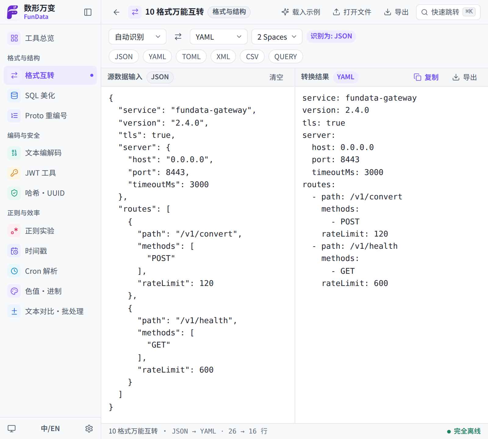
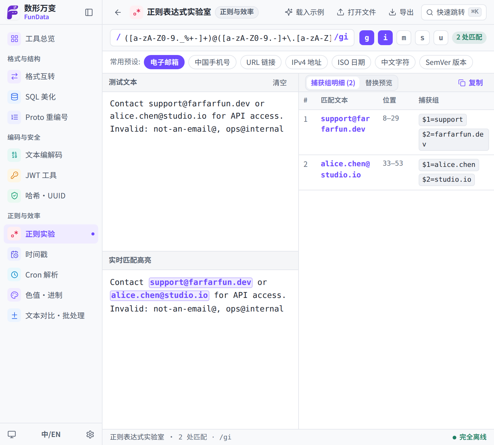
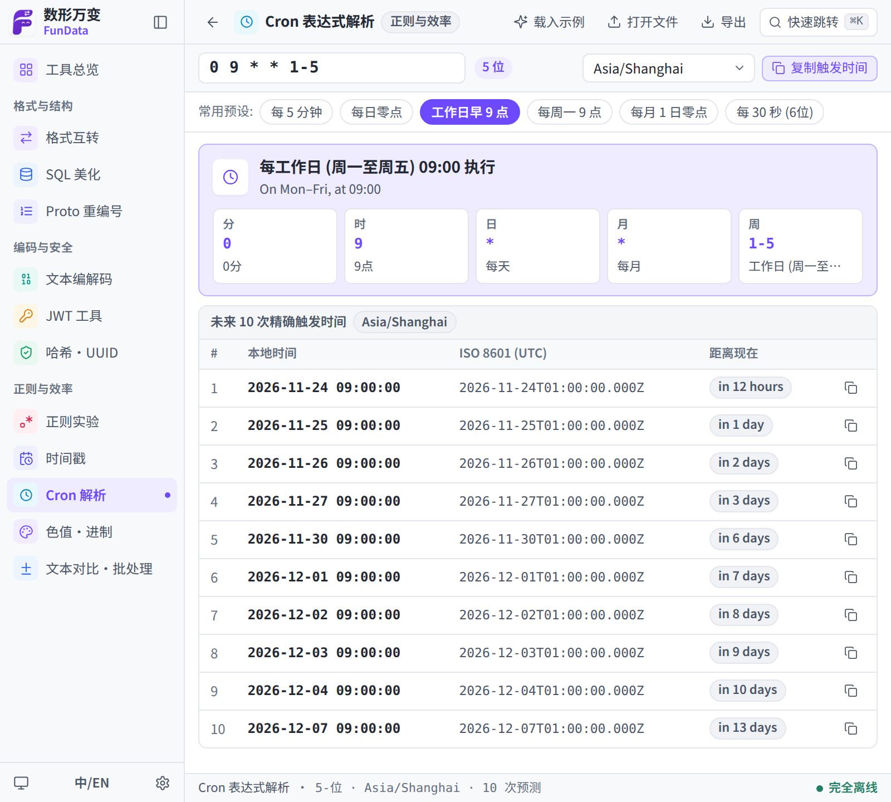

<p align="center"></p>
<h1 align="center">数形万变 · FunData</h1>
<p align="center">离线 11 合 1 开发者数据工具箱：多格式互转、SQL 美化、Protobuf、文本编解码、Unix 时间戳、JWT 验签签发、哈希/UUID、正则实验、Cron 解析、色值进制与文本对比。</p>
<p align="center"><a href="https://farfarfun.github.io/packages/utools-fundata/">产品主页</a> · <a href="https://github.com/farfarfun-utools/utools-fundata/actions">构建与截图</a> · <a href="https://github.com/farfarfun-utools/utools-fundata/issues">反馈问题</a> · <a href="https://github.com/farfarfun-utools/utools-plugins">更多插件</a></p>


## 11 款完全离线开发者工具

- **格式与结构**
  1. **10 格式万能互转**：JSON / JSON5 / YAML / TOML / XML / CSV / TSV / INI / NDJSON / URL Query 双向无损互转，支持源格式自动识别与一键互换。
  2. **SQL 格式化与美化**：支持 Standard SQL / MySQL / PostgreSQL / SQLite / BigQuery / T-SQL 6 种方言、关键字大小写风格与单行压缩。
  3. **Protobuf 重编号**：message 从 1 / enum 从 0 安全重编号，自动跳过 `reserved` / `extensions` 与 `19000..19999` 系统保留段，保留 `allow_alias` 别名与注释，支持并排 Diff 预览。
- **编码与安全**
  4. **文本编解码**：Base64（UTF-8 安全）/ URL / Unicode `\uXXXX` / HTML 实体 / Hex / JSON 字符串转义双向转换与一键互换。
  5. **JWT 解析、验签与签发**：无损保留超大整数（Snowflake ID），实时校验 `exp`/`nbf`/`iat` 状态，基于 Web Crypto 离线支持 HS256 / HS384 / HS512 验签与签发。
  6. **哈希 / HMAC 与 UUID / 密钥生成**：实时并行计算 MD5（纯 TS）/ SHA-1 / SHA-256 / SHA-384 / SHA-512（支持 HMAC 与 hex/HEX/Base64 切换），并支持 1–50 条批量生成 UUID v4 / ULID / NanoID / 随机 Hex / Base64URL 密钥。
- **正则与效率**
  7. **正则表达式实验室**：支持 `g/i/m/s/u` 标志、7 组高频预设（邮箱、手机号、URL、IPv4、ISO 日期、中文、SemVer）、实时匹配高亮、捕获组明细表与替换模板预览。
  8. **Unix 时间戳与多时区**：自动识别秒/毫秒 Unix 时间戳、日期时间双向互转、ISO 8601 / RFC 2822 格式输出，以及上海 / UTC / 纽约 / 伦敦 / 东京 5 时区实时对照。
  9. **Cron 表达式解析器**：支持 5 位与 6 位（含秒）Cron，中英文自然语言语义解释、逐字段拆解，并纯离线计算指定时区未来 10 次精确触发时间。
  10. **颜色 / 进制 / 字节换算**：HEX / RGB / RGBA / HSL 双向换算与 WCAG 对比度评级、BigInt 精确 2/8/10/16/36 进制同步换算、IEC（1024）/ SI（1000）存储单位换算。
  11. **文本对比与批处理**：双行号并排 Diff（支持忽略空白与 Patch 导出），以及去重、排序、逆序、去空行、Trim、批量加前后缀、实时统计与 Top 10 行频分析。

- **高效 Studio 交互**：左侧可折叠分类侧栏 + `⌘K` / `Ctrl+K` 模糊快速跳转面板 + 日夜双主题 + 中英双语，原生适配 `800×720` uTools 窗口与窄屏抽屉布局。

## uTools 入口

| 入口关键词 / 触发方式 | 行为 |
| --- | --- |
| `数形万变` / `FunData` / `数据转换` / `yaml` / `toml` | 打开工作室总览或格式互转 |
| `格式转换` / `xml` / `csv` / `ini` | 直达 10 格式万能互转 |
| `sql` / `SQL格式化` / `protobuf` | 直达 SQL 美化或 Protobuf 重编号 |
| `base64` / `编解码` / `时间戳` / `jwt` | 直达编解码与时间戳或 JWT 验签签发 |
| `hash` / `md5` / `sha256` / `uuid` | 直达哈希 / HMAC 与 UUID / 密钥生成 |
| `regex` / `正则` / `cron` / `文本对比` | 直达正则实验室、Cron 解析或文本对比 |
| 选中 `.yaml` / `.toml` / `.xml` / `.csv` / `.tsv` / `.ini` / `.ndjson` / `.proto` / `.sql` / `.txt` 文件 | 自动路由至对应工具加载文件内容 |
| 选中任意文本使用「用数形万变处理」 | 智能识别 JWT / Cron / SQL / Protobuf / YAML·TOML·XML·CSV / Base64·时间戳并直达对应工具 |

## AI / MCP 工具

数形万变已向 uTools 注册 5 个离线 AI / MCP 工具（需 uTools 8 及以上版本；供第三方 Agent 调用时需由用户手动开启 uTools MCP 服务）：

| 工具名 | 功能 | 说明 |
| --- | --- | --- |
| `convert_data_format` | 在 10 种常见数据格式之间无损互转 | 纯本地执行 |
| `decode_jwt` | 解析 JWT Header / Payload 与时间状态 | 不联网、不保存令牌 |
| `format_sql` | 多方言 SQL 美化与单行压缩 | 纯本地执行 |
| `parse_cron` | 解析 5/6 位 Cron 并计算未来 N 次触发时间 | 纯本地执行 |
| `compute_hash` | 计算 MD5 / SHA-1~512 哈希摘要或 HMAC | 纯本地执行 |

> **隐私声明**：插件 100% 离线运行，无账号、无埋点、无任何外部网络请求。仅在本地 `localStorage` 保存主题、语言、字号与时区偏好。

## 界面预览

| 10 格式万能互转（JSON → YAML） | 正则表达式实时实验室 |
| --- | --- |
|  |  |

| Cron 表达式与未来 10 次触发 | 深色模式工作室（哈希与 HMAC） |
| --- | --- |
|  |  |

## 安装与构建

需要 **Node.js ≥ 22.22.2**，pnpm 版本见 `package.json#packageManager`。

```bash
git clone https://github.com/farfarfun-utools/utools-fundata.git
cd utools-fundata
pnpm install
sh build.sh
```

在 uTools 开发者工具中新建项目并选择 `utools/plugin.json` 即可加载调试。常用开发脚本：

```bash
pnpm dev          # 本地开发服务器
pnpm lint         # ESLint 检查
pnpm typecheck    # Vue / TypeScript 类型检查
pnpm test         # Vitest 单元测试与组件集成测试
pnpm screenshots  # 构建产物并运行无头浏览器检查与截图
sh build.sh       # 完整校验与生产构建
```

## 许可

[MIT](LICENSE) · [farfarfun-utools](https://github.com/farfarfun-utools)
