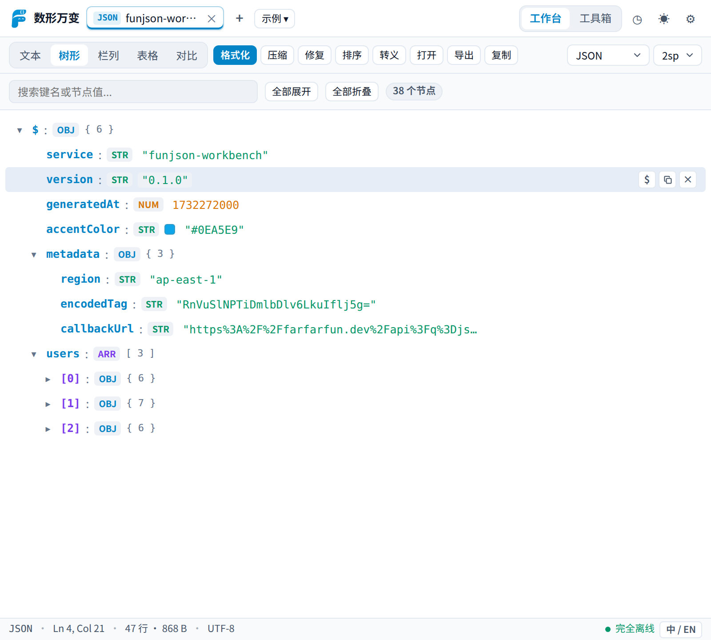
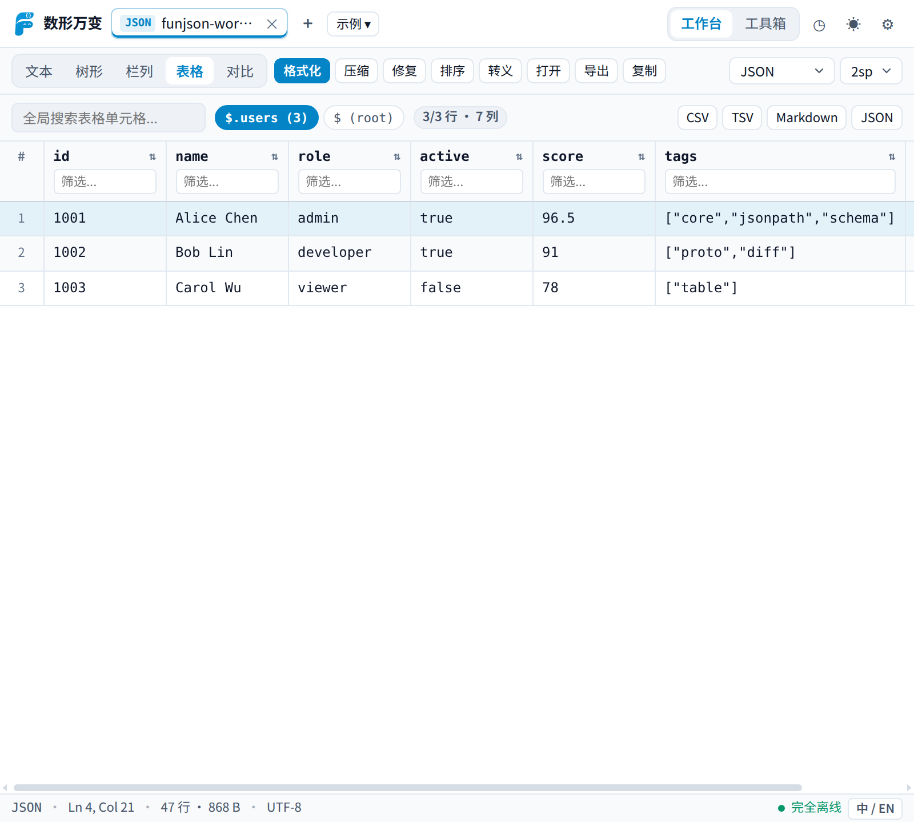
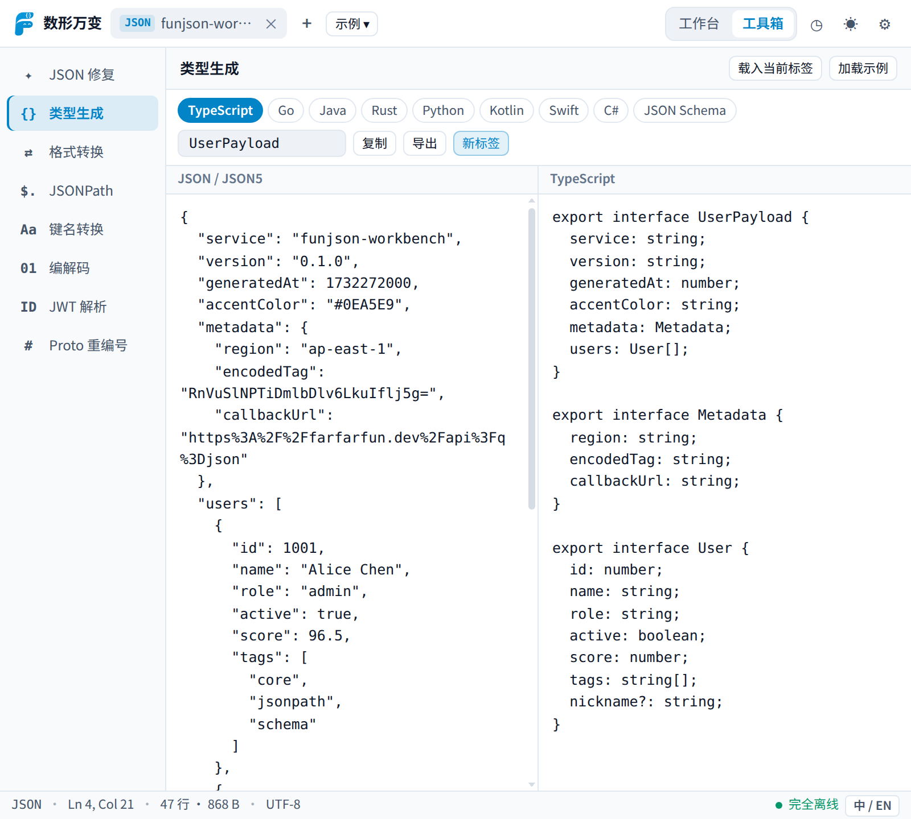
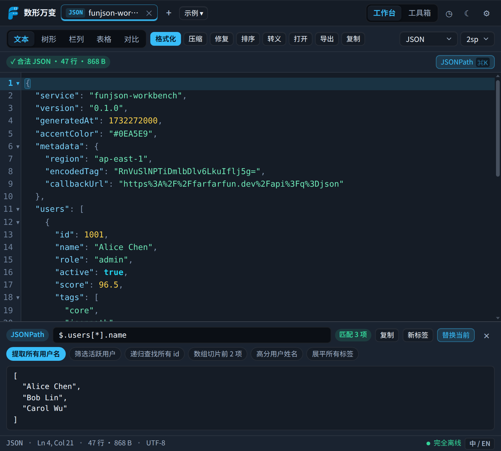

<p align="center"></p>
<h1 align="center">数形万变 · FunJSON</h1>
<p align="center">离线 JSON 与多格式数据处理工作台：五视图编辑、RFC 9535 JSONPath、智能解码与 8 合 1 开发者工具箱。</p>
<p align="center"><a href="https://farfarfun.github.io/packages/utools-funjson/">产品主页</a> · <a href="https://github.com/farfarfun-utools/utools-funjson/actions">构建与截图</a> · <a href="https://github.com/farfarfun-utools/utools-funjson/issues">反馈问题</a> · <a href="https://github.com/farfarfun-utools/utools-plugins">更多插件</a></p>


## 核心功能

- **多标签工作台**：支持多文档标签（格式徽标、双击重命名、拖拽打开本地文件）、自动格式识别与历史版本快照对比恢复。
- **五大视图自由切换**：
  - **文本视图（CodeMirror 6）**：语法高亮、行号、代码折叠、括号匹配、实时 JSON 语法校验与精准行列报错定位；内置**智能解码条**（光标悬停自动识别时间戳、Base64、URL、Unicode、嵌套 JSON 字符串及颜色色块）与可折叠 **RFC 9535 JSONPath 查询栏**；`.proto` 文件支持一键重排编号。
  - **树形视图**：可折叠交互树，支持关键字筛选、全部展开/折叠、原始值内联编辑、增删节点与一键复制 JSONPath。
  - **栏列视图（Miller Columns）**：类 Finder 分栏只读探索器，支持面包屑跳转与右侧智能值检视器。
  - **表格视图**：自动识别对象数组字段（如 `$.users`），支持全局搜索、按列过滤、点击列头排序及一键导出 CSV / TSV / Markdown / JSON。
  - **差异对比视图**：左右双栏并排编辑与实时行级差异高亮，支持**语义对比（忽略键顺序）**与一键格式化两侧。
- **8 合 1 开发者工具箱**：
  1. **JSON 修复**：离线 `jsonrepair` 引擎 + 可选 uTools AI / OpenAI 兼容接口修复。
  2. **类型生成**：JSON 一键生成 TypeScript / Go / Java / Rust / Python / Kotlin / Swift / C# / JSON Schema（9 种目标语言）。
  3. **格式转换**：JSON / JSON5 / YAML / TOML / XML / CSV / TSV / INI / NDJSON / URL Query 10 格式无损互转。
  4. **JSONPath 练习与筛选**：内置 6 组 RFC 9535 示例芯片，实时展示匹配结果与规范路径。
  5. **键名风格转换**：`camelCase` / `snake_case` / `PascalCase` / `kebab-case` / `CONSTANT_CASE` / `dot.case` 递归转换与忽略键设置。
  6. **编解码与时间戳**：Base64 / URL / Unicode / HTML / Hex / JSON String 双向编解码，以及 Unix 时间戳与日期时间互转。
  7. **JWT 解析与验签**：无损保留超大整数（Snowflake ID），自动校验 `exp`/`nbf`/`iat` 状态，并基于 Web Crypto 离线校验 HS256 / HS384 / HS512 签名。
  8. **Protobuf 重编号**：遵循 `reserved` 区间、自动跳过 `19000..19999` 系统保留段并保持 `allow_alias` 枚举别名同步，支持并排差异预览与 `.proto` 导出。
- **日夜双主题与双语界面**：Cerulean-Obsidian 工作室风格，支持浅色 / 深色 / 跟随系统与中英切换，适配 `800×720` uTools 窗口与窄屏布局。

## uTools 入口

| 入口关键词 / 触发方式 | 行为 |
| --- | --- |
| `数形万变` / `FunJSON` / `json` / `JSON格式化` / `数据转换` / `yaml` / `toml` / `xml` / `jwt` / `protobuf` | 打开工作台 |
| 剪贴板或输入框匹配 `{...}` / `[...]`（`JSON 格式化`） | 新建标签载入并自动格式化 JSON |
| 选中 `.json` / `.yaml` / `.toml` / `.xml` / `.csv` / `.proto` / `.sql` 等文件 | 自动识别格式并在多标签中打开 |
| 选中任意文本使用「用数形万变解析」 | 自动检测数据格式并载入工作台 |

## AI / MCP 工具

数形万变已向 uTools 注册 5 个离线 AI / MCP 工具（需 uTools 8 及以上版本；供第三方 Agent 调用时需由用户手动开启 uTools MCP 服务）：

| 工具名 | 功能 | 说明 |
| --- | --- | --- |
| `format_json` | 校验、格式化、压缩、按键排序与自动修复 JSON / JSON5 | 纯本地执行 |
| `query_jsonpath` | 使用 RFC 9535 JSONPath 查询 JSON 数据并返回匹配项与路径 | 纯本地执行 |
| `convert_data_format` | 在 10 种常见数据格式之间无损互转 | 纯本地执行 |
| `json_to_types` | 从 JSON 样本生成 9 种目标语言类型定义或 JSON Schema | 纯本地执行 |
| `decode_jwt` | 解析 JWT Header / Payload 与时间状态 | 不联网、不保存令牌 |

> **隐私声明**：插件默认 100% 离线运行，无账号、无埋点、无外部字体或 CDN 请求。工作区标签与偏好设置仅保存在本机 `localStorage` 中；仅当用户在设置中主动配置并触发远程 AI 修复时，才会将待修复文本发送至用户指定的 AI 接口。

## 界面预览

| 树形视图 | 表格视图与筛选排序 |
| --- | --- |
|  |  |

| 8 合 1 工具箱（类型生成） | 深色模式与 JSONPath |
| --- | --- |
|  |  |

## 安装与构建

需要 **Node.js ≥ 22.22.2**，pnpm 版本见 `package.json#packageManager`。

```bash
git clone https://github.com/farfarfun-utools/utools-funjson.git
cd utools-funjson
pnpm install
sh build.sh
```

在 uTools 开发者工具中新建项目并选择 `utools/plugin.json` 即可加载调试。常用开发脚本：

```bash
pnpm dev          # 本地开发服务器
pnpm lint         # ESLint 检查
pnpm typecheck    # Vue / TypeScript 类型检查
pnpm test         # Vitest 单元测试与组件集成测试
pnpm screenshots  # 构建产物并运行无头浏览器检查与截图
sh build.sh       # 完整校验与生产构建
```

## 许可

[MIT](LICENSE) · [farfarfun-utools](https://github.com/farfarfun-utools)
